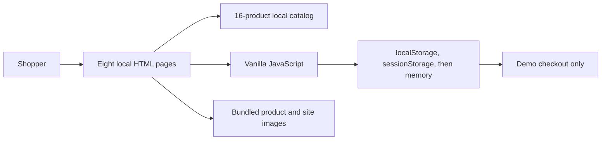
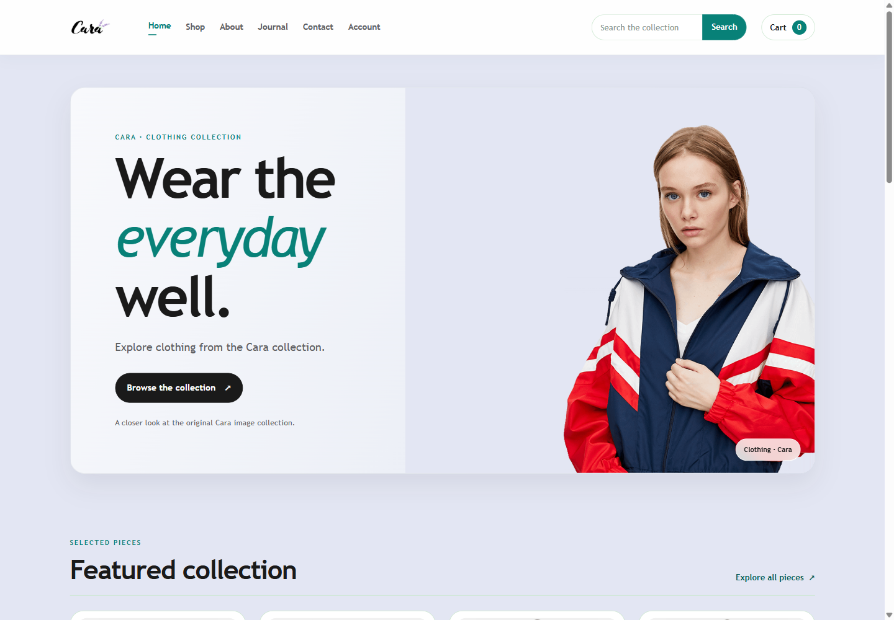
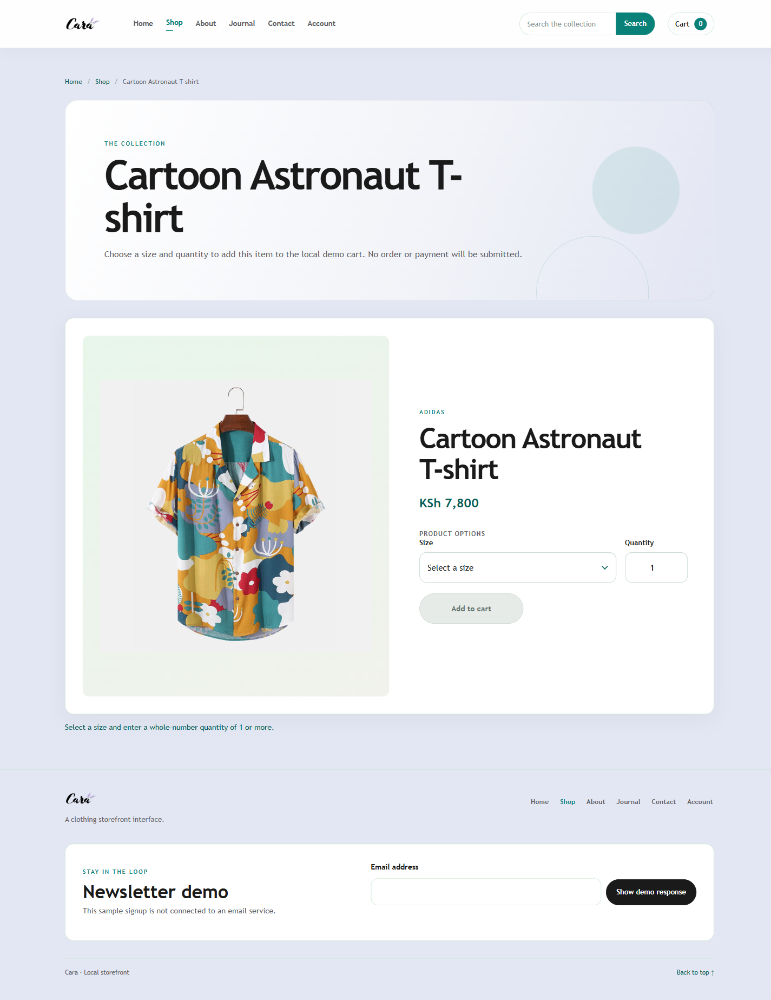
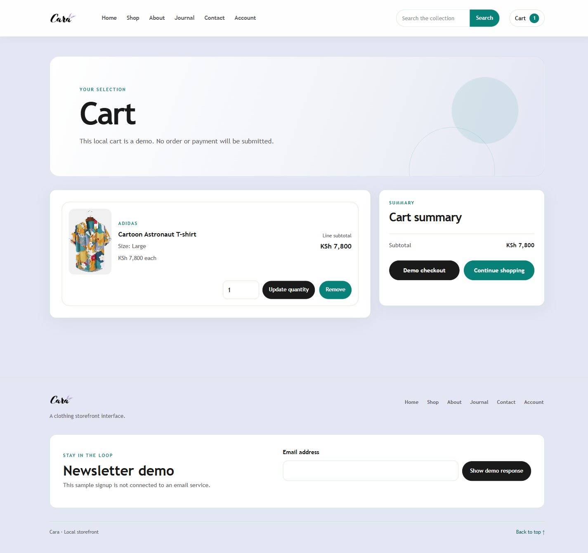

# 🛍️ Cara: A Browser-Only Clothing Storefront

**Cara** is a self-contained clothing storefront I revisited after following a five-hour YouTube tutorial for a university HTML and CSS assignment. I wanted to bridge the gap between its static product screens and a complete browser-only shopping flow, using a production-grade structure while keeping the Cara identity, Kenyan-shilling prices, and bundled images.

---

## 🎯 Project Goal

The assignment helped me learn how a storefront is structured, but the shopping journey stopped at a static product button. I returned to Cara to make the main customer flow work in the browser: browse the catalog, search and page through products, select a size and quantity, manage the cart, and complete a clearly labeled demo checkout.

---

## 🧬 System Architecture



1. **Pages** — Eight semantic HTML pages preserve the original browse, product, cart, and supporting sections.
2. **Catalog and media** — A local JavaScript catalog supplies 16 products, KSh prices, sizes, and paths to the bundled images.
3. **Storefront interactions** — Browser JavaScript handles search, pagination, product selection, cart updates, and form feedback.
4. **Cart state** — The cart uses local storage, falls back to session storage, then stays in memory if browser storage is unavailable. Demo checkout clears the cart without placing an order.

---

## 🛠️ Technical Stack

| **Layer** | **Tool** | **Version** | **Purpose** |
| --- | --- | --- | --- |
| **Structure** | Semantic HTML | HTML Living Standard | Eight local pages and accessible landmarks |
| **Presentation** | CSS | CSS3 | Responsive storefront styling and page layouts |
| **Interactions** | Browser JavaScript | ES2015+ | Search, pagination, product selection, cart, and forms |
| **State** | Web Storage APIs | Browser-native | Persist the demo cart with tab and memory fallbacks |
| **Local preview** | Python HTTP server | Python 3 | Serve the static pages and relative image paths |

---

## 📊 Performance & Results

- The rebuilt storefront contains **8 pages** and a **16-product** local catalog.
- Manual review covered all 8 routes and **189 local links, images, and script references**.
- Responsive review covered **320px, 390px, and 1440px** widths without horizontal overflow.
- The review covered search, pagination, size and quantity selection, cart add/update/remove, size-specific lines, checkout, storage fallback, and non-transmitting demo forms.
- `node --check` passed for all three JavaScript files, and `git diff --check` passed. No automated test suite was added or run.

---

## 📸 Screenshots

<p align="center">
  
  
  
</p>
<p align="center"><sub>Home and featured collection · Product detail · Cart with a local demo item</sub></p>

---

## 🛍️ Storefront Pages

| **Page** | **Local file** | **What I kept working** |
| --- | --- | --- |
| Home | `src/index.html` | Hero, featured products, new arrivals, and local navigation |
| Shop | `src/shop.html` | Search, local catalog, and pagination |
| Product | `src/sproduct.html?id=f1` | Product details, size choice, quantity validation, and add to cart |
| Cart | `src/cart.html` | Size-specific lines, quantity updates, removal, totals, and demo checkout |
| About | `src/about.html` | Bundled imagery with copy clearly presented as demo content |
| Journal | `src/blog.html` | Bundled article imagery and sample-labeled editorial copy |
| Contact | `src/contact.html` | Local-only form feedback; nothing is sent or retained |
| Account Demo | `src/home.html` | Guest shopping without credential fields |

---

## 🧠 Key Design Decisions

- **Keep the assignment recognizable:** I kept Cara's name, page set, product imagery, and KSh pricing while making the shopping controls work.
- **Keep it browser-only:** There is no backend, login service, external API, real order, or payment processor.
- **Keep sample content clear:** About and Journal copy is labeled as demo content, and the old login destination is a guest Account Demo.
- **Keep demo inputs local:** Contact and newsletter actions show a browser message; they do not send or store the entered information.

---

## 📂 Project Structure

```text
Cara/
├── img/
│   ├── about/              # Local image and video assets
│   ├── banner/
│   ├── blog/
│   ├── features/
│   ├── pay/
│   ├── people/
│   └── products/           # 16 catalog images
├── src/
│   ├── about.html
│   ├── blog.html
│   ├── cart.html
│   ├── contact.html
│   ├── home.html           # Account Demo
│   ├── index.html
│   ├── shop.html
│   ├── sproduct.html
│   ├── style.css
│   └── js/
│       ├── app.js
│       ├── cart.js
│       └── products.js
└── docs/screenshots/       # Browser captures used in this README
```

---

## ⚙️ Installation & Setup

1. Clone the repository and open a terminal in the `Cara` folder.
2. Start a local static server:

   ```powershell
   py -m http.server 8000
   ```

3. Open the home page:

   | **Page** | **URL** |
   | --- | --- |
   | Storefront | `http://127.0.0.1:8000/src/index.html` |

No package installation or build step is required. Run the server from the repository root so all relative pages and images resolve.

---

## 🧺 Cart and Checkout Rules

- A cart line is identified by product and size; matching lines merge.
- Quantities must be positive whole numbers, and totals are guarded against unsafe integer values.
- Visitors can update or remove lines and continue shopping from the cart.
- Demo checkout clears the local cart. It does not create an order or request payment.

---

## 🎓 Skills Demonstrated

- **Semantic frontend structure:** Organizing a multi-page storefront with accessible landmarks and navigation.
- **Responsive interface implementation:** Building layouts that remain usable from narrow phone widths through desktop.
- **Client-side state management:** Maintaining a cart with browser-storage fallbacks and safe quantity handling.
- **Browser interaction design:** Connecting catalog search, pagination, product details, and cart flows without a backend.
- **Scope and privacy communication:** Clearly labeling demo content and explaining which forms do not transmit data.
